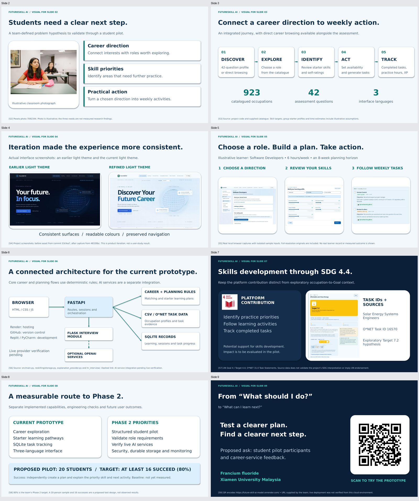

# FutureSkill AI — slide images and source pack

Eight PNG visuals for the original deck's Slides 2–9, plus full-resolution product screenshots, source credits and editable PowerPoint diagrams.

## Use in Canva

1. Upload `FutureSkill_Slides_2-9_Editable_Visuals.pptx` to import editable slides, or upload the individual PNGs.
2. Use `screens/` for large, readable product detail images. The screenshots use isolated sample inputs, not actual learners.
3. Keep source credits with the visuals. `SOURCES.md` explains citations and limitations; `sources.csv` is spreadsheet-friendly.
4. `reference-images/` contains the unchanged classroom photograph and official Goal 4/8 icons, plus the demo QR.

| Original slide | Image | Content | Sources |
| --- | --- | --- | --- |
| 2 | [PNG](slide-02.png) | Problem hypothesis + classroom illustration | [Sources](SOURCES.md#slide-2) |
| 3 | [PNG](slide-03.png) | Career-to-learning workflow | [Sources](SOURCES.md#slide-3) |
| 4 | [PNG](slide-04.png) | Real before/after light-theme screenshots | [Sources](SOURCES.md#slide-4) |
| 5 | [PNG](slide-05.png) | Real sample career/skills/task journey | [Sources](SOURCES.md#slide-5) |
| 6 | [PNG](slide-06.png) | Code-based architecture | [Sources](SOURCES.md#slide-6) |
| 7 | [PNG](slide-07.png) | SDG4.4 contribution + actual O*NET task evidence | [Sources](SOURCES.md#slide-7) |
| 8 | [PNG](slide-08.png) | Proposed Phase 2 plan and80% target | [Sources](SOURCES.md#slide-8) |
| 9 | [PNG](slide-09.png) | Closing + demo QR | [Sources](SOURCES.md#slide-9) |

## Editable and reproducible files

- `FutureSkill_Slides_2-9_Editable_Visuals.pptx`: editable presentation source.
- `FutureSkill_Slides_2-9_Editable_Visuals.pdf`: fixed-layout preview.
- `build_visuals.py`: regenerates the PowerPoint using the supplied image files. Install `python-pptx`, `Pillow` and `reportlab` in a separate environment, then run it from the extracted pack.
- `metadata.json`: source commit, counts and capture context.
- `sdg-example-data.json`: API evidence underlying the SDG sample.
- `slide-assets.zip`: portable download of the complete pack.

The uploaded original deck and the live website are unchanged by preparing this pack. The 20-person pilot is proposed, 80% is a target, and the baseline is not yet measured. No live OpenAI inference or Render deployment verification is claimed.
