# FutureSkill AI 页面预览

以下是新版页面的实际浏览器截图。首页运行时蓝色粒子球和轨道会缓慢运动，截图呈现静态画面。

SDG mapping 的 HUD 排版、循环激光边框和动效预览在本页下方。

[查看最新 SDG 圆形布局](#sdg-circular-layout)

## 深色模式

### 桌面版

### 手机版

## 浅色模式（Light mode）

当前浅色设计保留深蓝导航、粒子球首屏和页脚；下方的流程、功能卡片使用浅蓝背景、白色卡片和深色文字。

右上角按钮显示的是切换目标：页面处于深色模式时显示 **Light mode**；处于浅色模式时显示 **Dark mode**。

### 桌面版

### 手机版

## SDG mapping · Cyberpunk HUD

这一节保留上一版矩形布局用于对比。最新圆形布局见下方。

深蓝网格背景、圆形关联仪表、17 个 SDG 节点、证据面板，以及沿矩形边缘循环移动的激光高光。浅色主题、手机布局和系统减少动态效果设置均保留。

下面使用实际 API 选择 Data Analyst 后捕获：2 个已审核潜在关联、17 个目标、15 个未评估目标，以及 targets 4.4 / 8.5。这些数量不表示影响分数。

### 激光边框动效

以下 GIF 为约 8 秒的真实页面录制，包含完整一圈的激光边框循环，以及雷达装饰、关联线的运动。

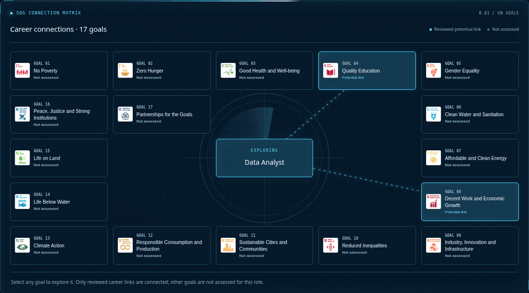

### 深色桌面版

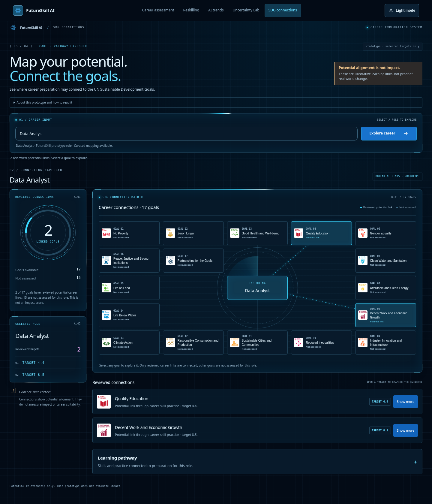

### 深色手机版

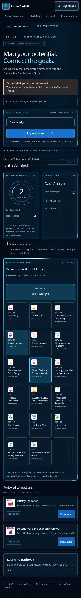

### 浅色桌面版

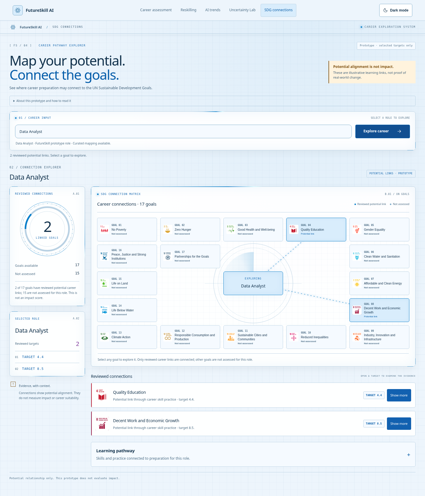

### 浅色手机版

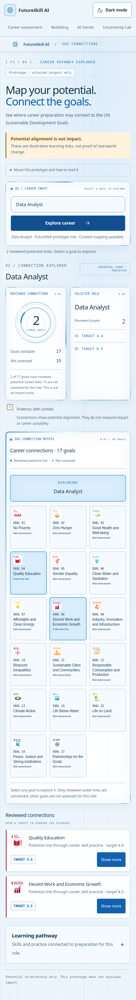

## SDG circular layout

17 个 SDG 节点按 360° / 17（约 21.18°）等角度排列，从 12 点方向的 Goal 1 开始顺时针分布，职业位于中心。Goal 17 留在同一外圈，连接线在圆形边缘外停止。

只有与当前职业有已审核潜在关联的 Goal 圆环运行激光；大面板、搜索框和侧栏保持静态边框。手机端采用圆形节点网格，保留清晰的点击区域。

### 圆形图谱特写

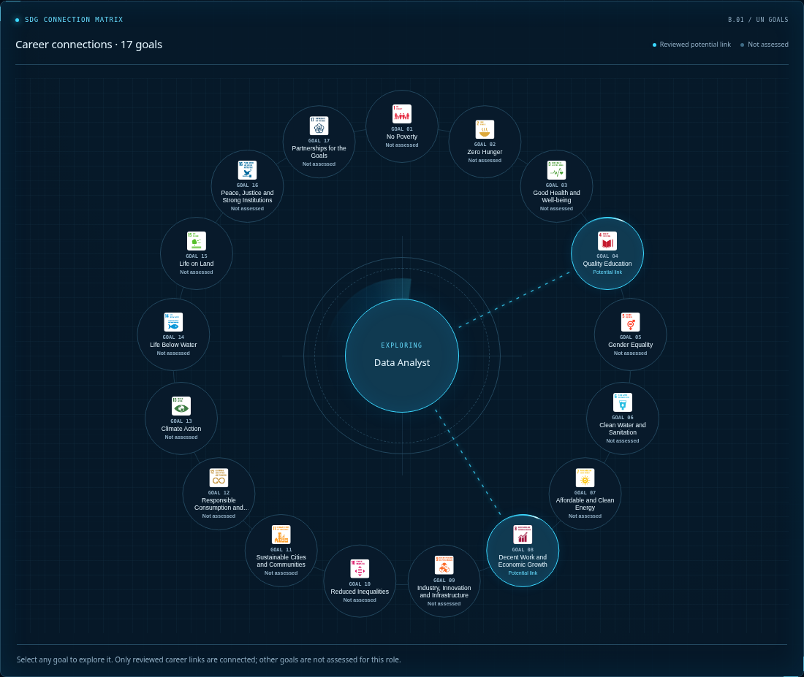

### Goal 圆环激光动效

以下为约 8 秒的真实浏览器录制。

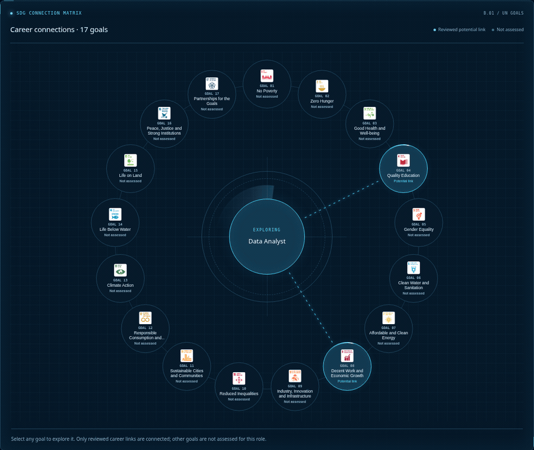

### 深色桌面版

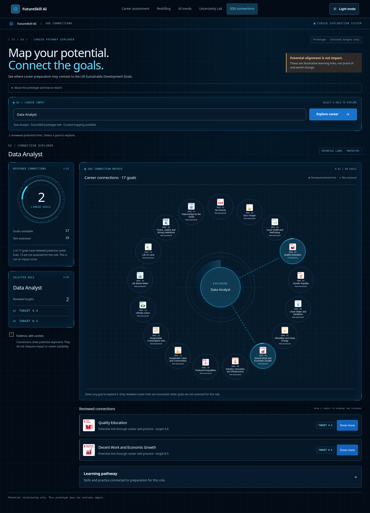

### 深色手机版

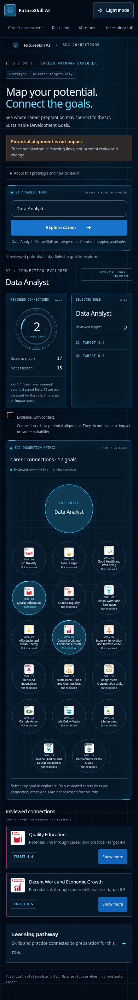

### 浅色桌面版

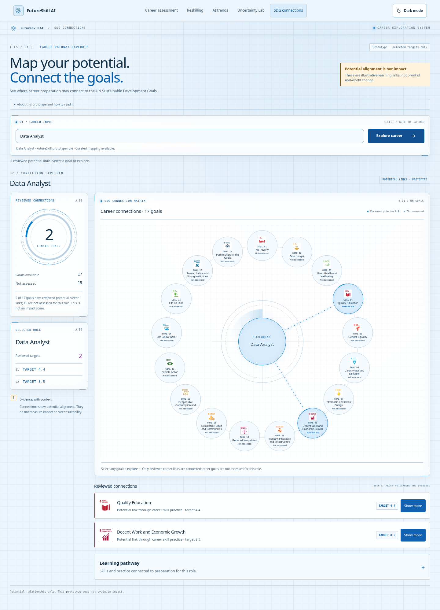

### 浅色手机版

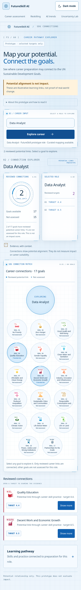
