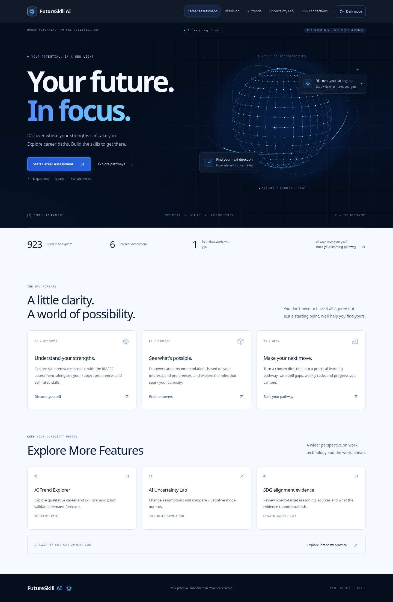
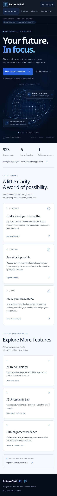

# FutureSkill AI 首页预览

以下是新版首页的实际浏览器截图。运行时蓝色粒子球和轨道会缓慢运动，截图呈现静态画面。

## 深色模式

### 桌面版

### 手机版

## 浅色模式（Light mode）

当前浅色设计保留深蓝导航、粒子球首屏和页脚；下方的流程、功能卡片使用浅蓝背景、白色卡片和深色文字。

右上角按钮显示的是切换目标：页面处于深色模式时显示 **Light mode**；处于浅色模式时显示 **Dark mode**。

### 桌面版

### 手机版

