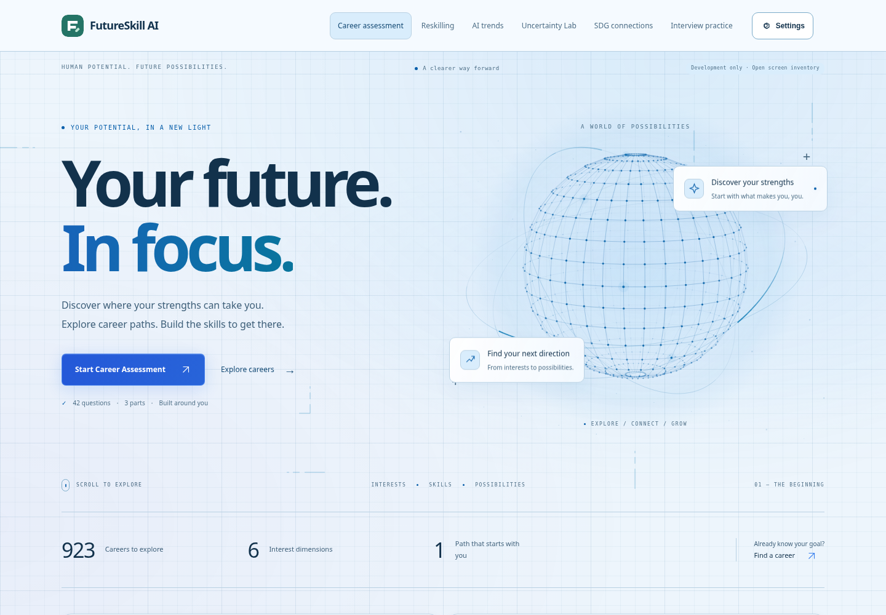
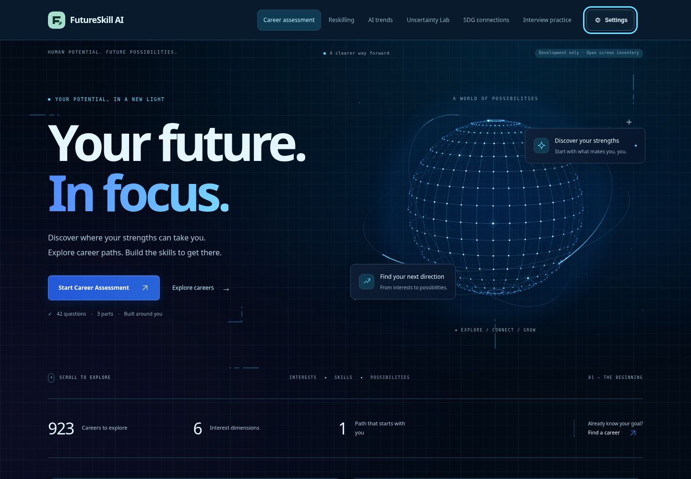
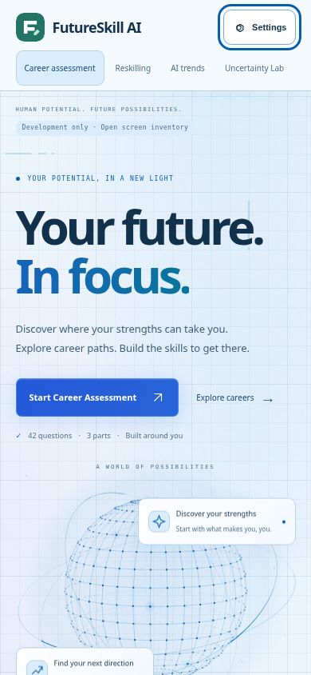
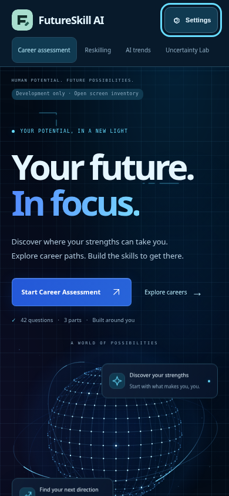
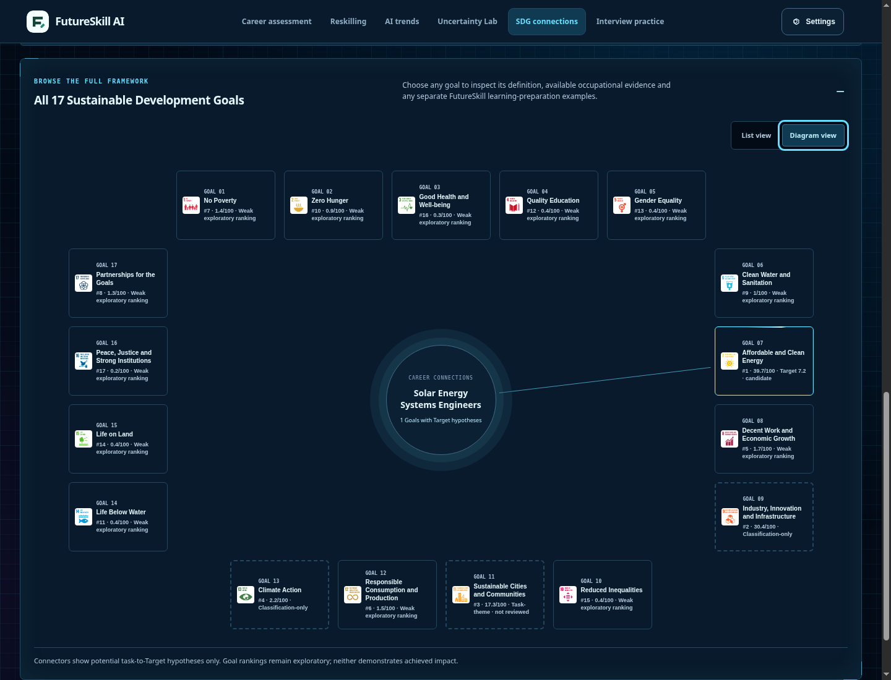

# 当前整合版预览

以下为基于当前网站功能拍摄的实际浏览器截图。全站共享网格激光背景；首页完整支持浅色与深色模式，保留当前职业浏览、Settings 和语言切换。

| 首页浅色 | 首页深色 |
| --- | --- |
|  |  |

| 手机浅色 | 手机深色 |
| --- | --- |
|  |  |

## SDG Diagram view

保留当前 Top 3、任务证据与全部 Goal 列表；在 All 17 Goals 展开区选择 **Diagram view** 可查看 5–4–4–4 排版。仅有实际任务与 Target 假设的 Goal 显示连线与边框光束；手机使用列表。

本地运行请见 [PyCharm 运行步骤](../../pycharm-local-run.md)。
