# 全站赛博朋克背景预览

共享深蓝／浅蓝网格、青色配色及缓慢流动的环境光。少量激光沿网格线传播并在交点转弯，桌面 6 条、手机 3 条。系统减少动态效果时停止背景运动，标签页隐藏时暂停光束。以下均为实际页面截图或浏览器录屏。

实现代码：[共享背景与页面配色](../../../src/static/future-cyber.css) · [主题切换与导航](../../../src/static/future-theme.js)。各页面在原样式之后引入共享 CSS，HR 模块也已接入明暗主题。更新位于 `codex/blue-tech-homepage` 分支，需要同步到 Replit 并重新发布，才会出现在已上线网站。

## 首页

浅色模式已完整覆盖导航、首屏、地球、悬浮信息卡及页脚。

[浅色动态预览](home-light-laser.gif) · [深色动态预览](home-dark-laser.gif) · [浅色完整页面](home-light-full.png) · [深色完整页面](home-dark-full.png)

| 深色模式 | 浅色模式 |
| --- | --- |
| 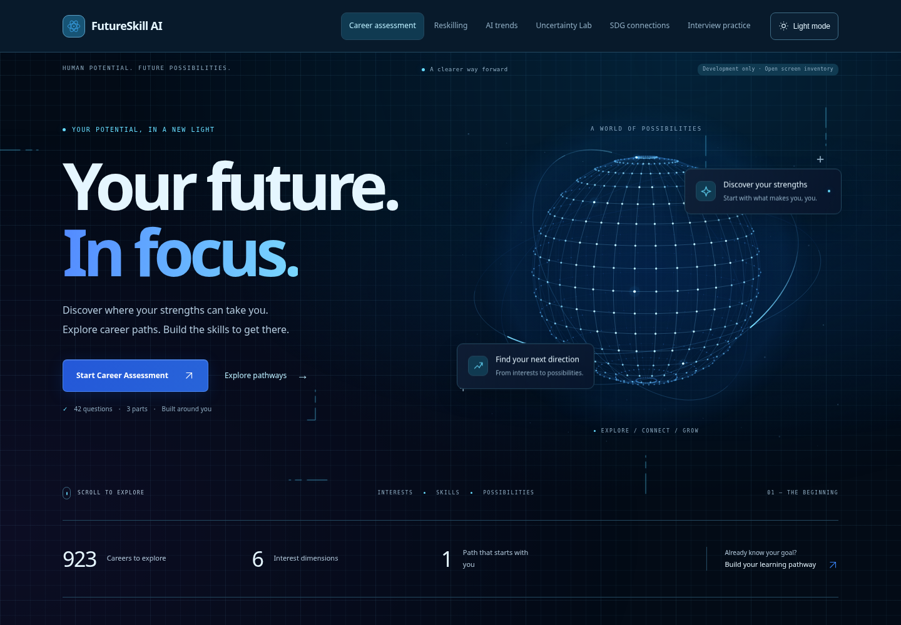 | 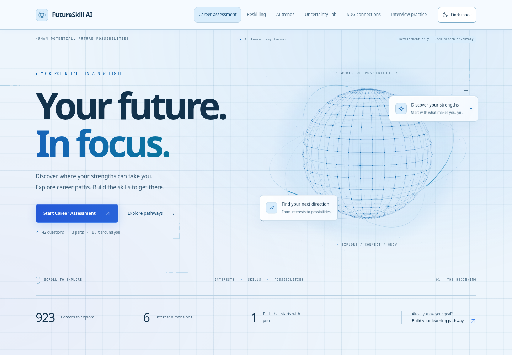 |

| 手机深色模式 | 手机浅色模式 |
| --- | --- |
| 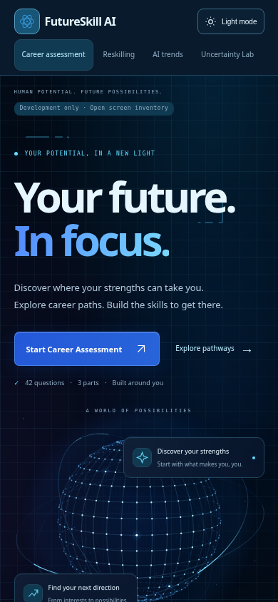 | 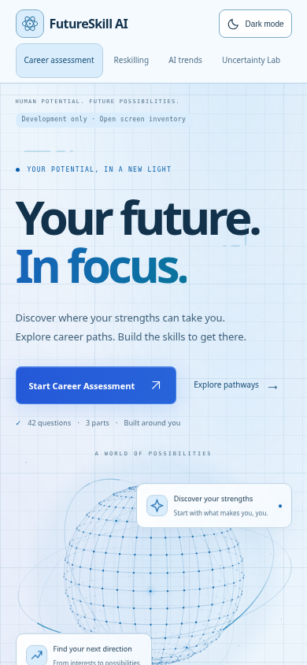 |

## 学习路径

| 深色模式 | 浅色模式 |
| --- | --- |
| 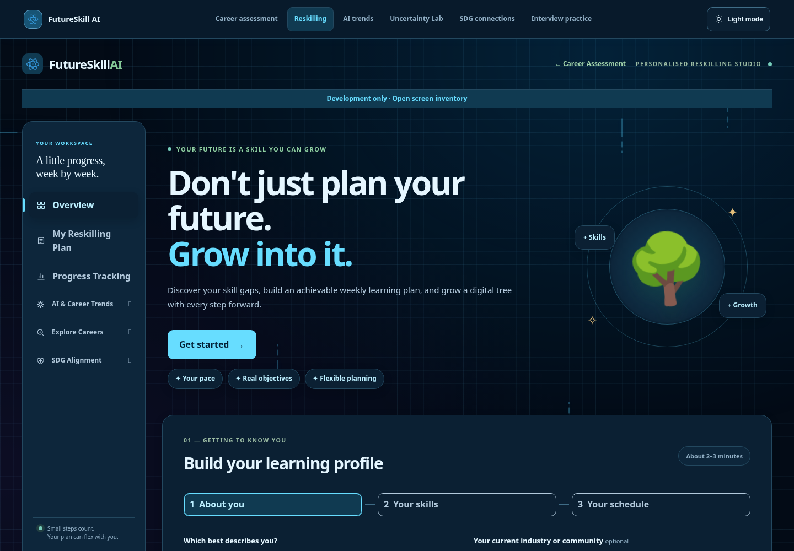 | 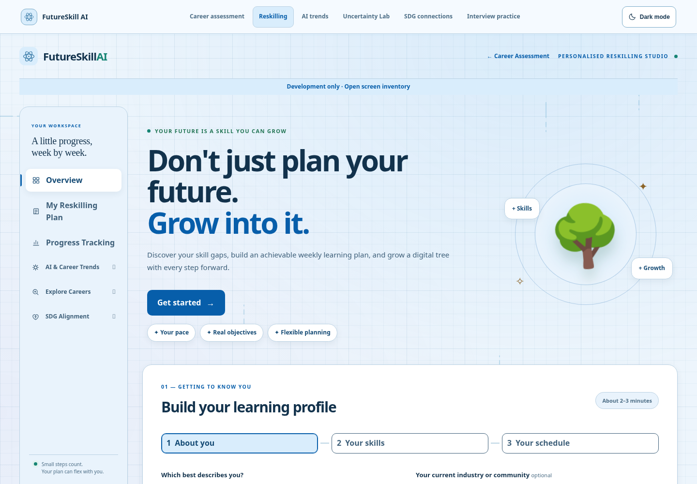 |

## AI 趋势

| 深色模式 | 浅色模式 |
| --- | --- |
| 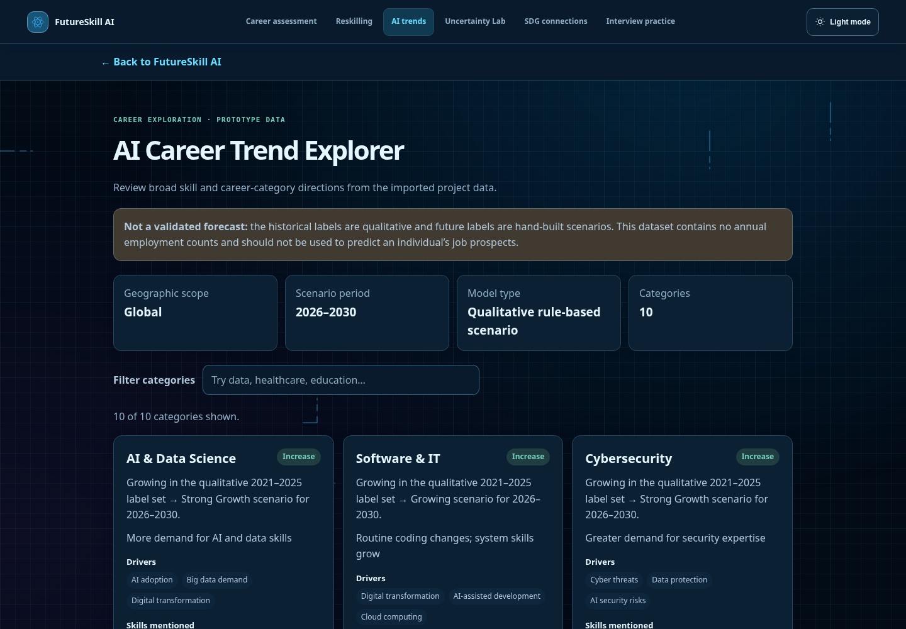 | 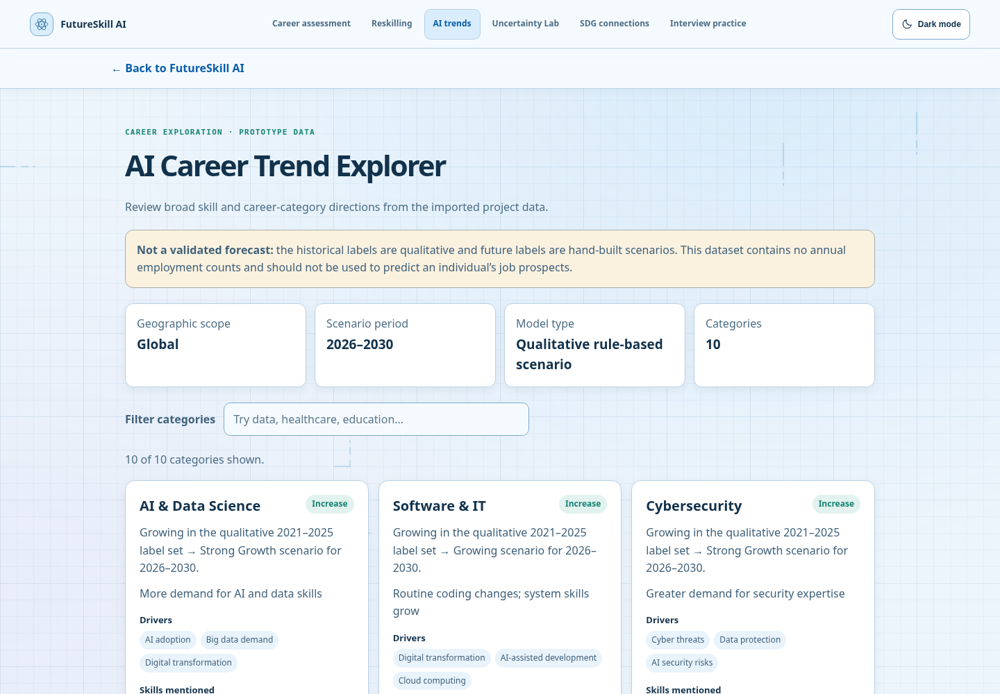 |

## Uncertainty Lab

| 深色模式 | 浅色模式 |
| --- | --- |
| 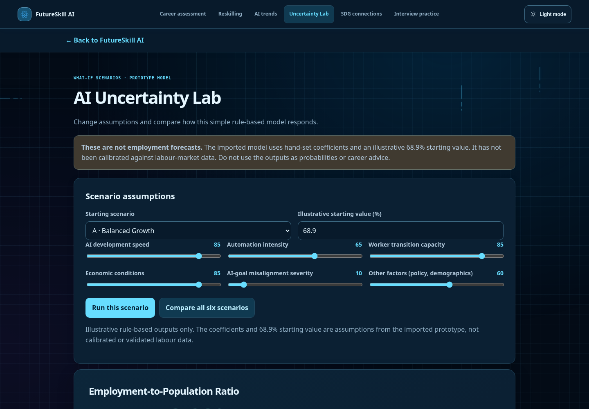 | 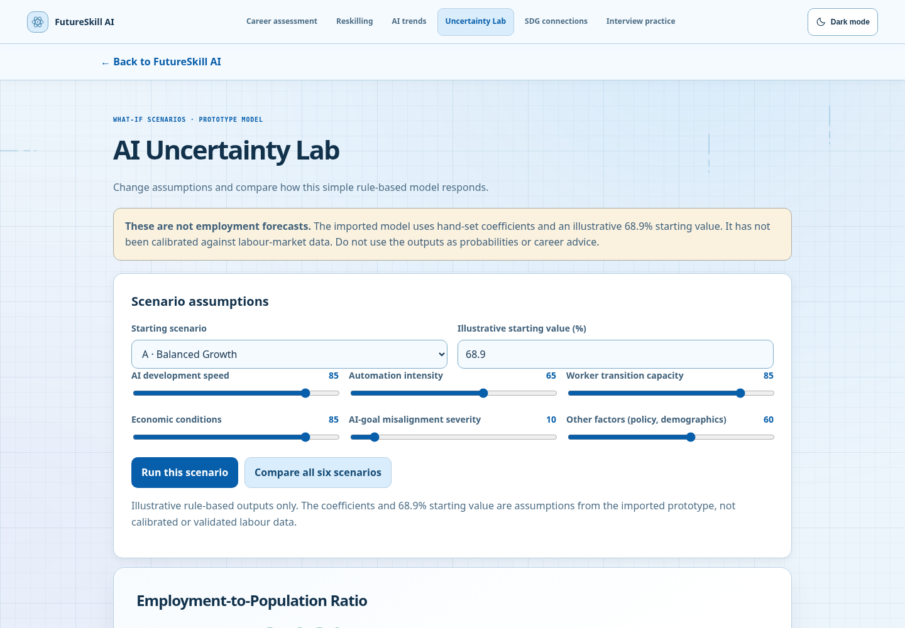 |

## SDG Mapping

| 深色模式 | 浅色模式 |
| --- | --- |
| 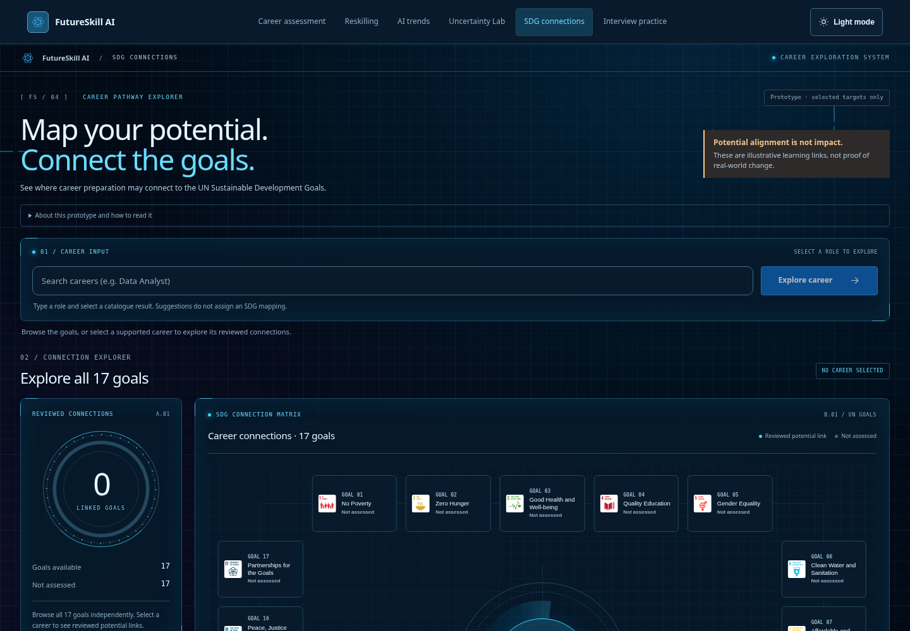 | 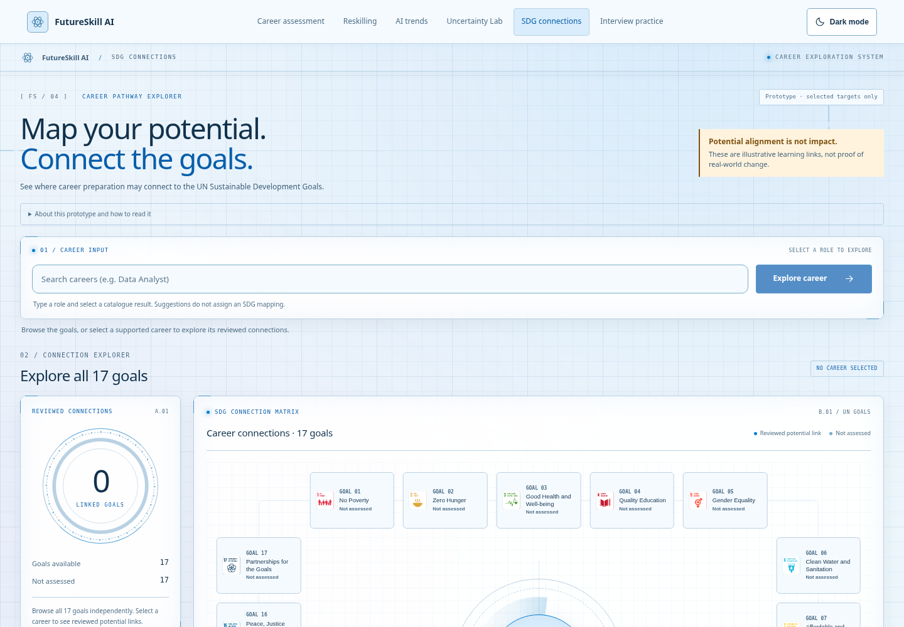 |

## HR 面试

| 深色模式 | 浅色模式 |
| --- | --- |
| 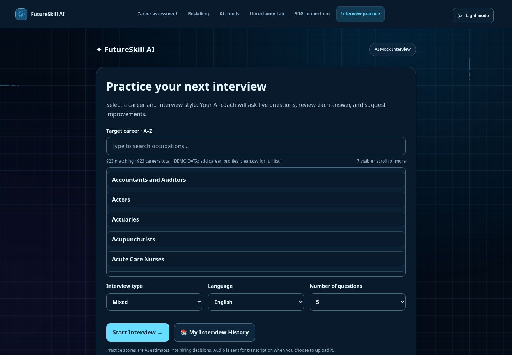 | 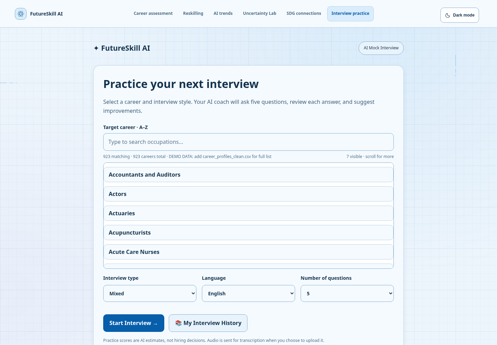 |

## 开发页面目录

| 深色模式 | 浅色模式 |
| --- | --- |
| 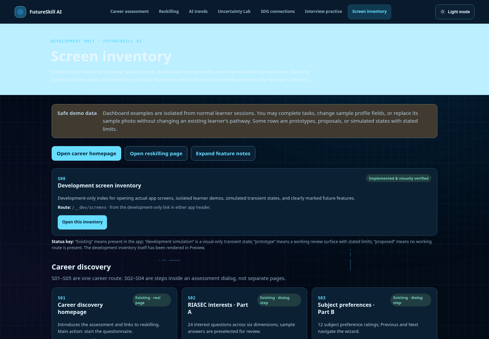 | 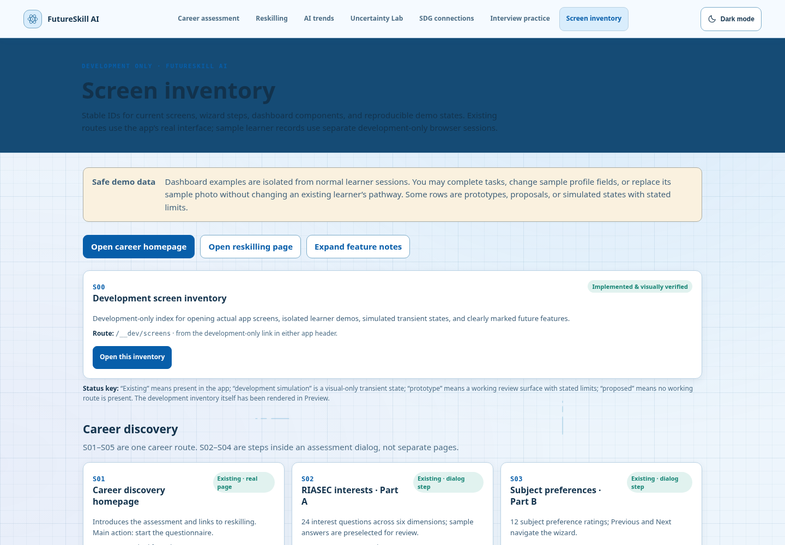 |
